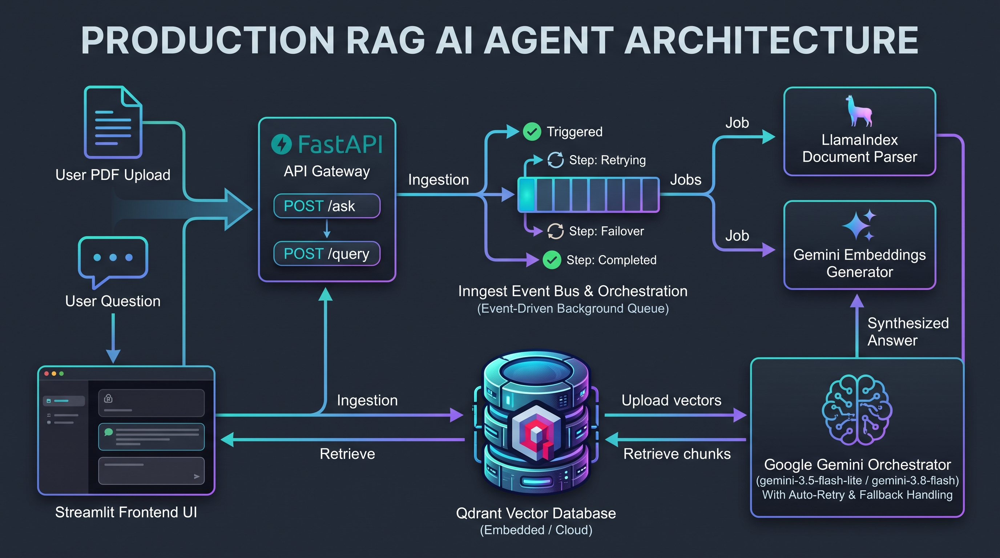

# Production-Grade Resilient RAG Agent


A production-ready, event-driven Retrieval-Augmented Generation (RAG) system built with **FastAPI**, **Inngest**, **Qdrant**, **LlamaIndex**, and **Google Gemini**, complete with an interactive **Streamlit** user interface.

Unlike basic script-based RAG implementations, this system decouples compute-heavy ingestion workflows from the API layer using event-driven background queues, step-level idempotency, and automated retries.

---

## Key Architecture & Features

```
[ User PDF Upload ] ──► [ Streamlit UI ]
                              │
                              ▼ (Triggers Event)
                      [ Inngest Dev Server / Queue ]
                              │
                    ┌─────────┴─────────┐
                    ▼                   ▼
           Step 1: Chunking    Step 2: Vector Embeddings
             (LlamaIndex)         (gemini-embedding-001)
                    │                   │
                    └─────────┬─────────┘
                              ▼
                     [ Qdrant Vector DB ]
                              ▲
                              │ Vector Similarity Search
                              ▼
                   [ Gemini Flash Reasoning ]
                              │
                              ▼
                     [ Synthesized Answer ]
```

- **Event-Driven Orchestration (Inngest):** Document parsing, chunking, and embedding run as multi-step background workflows with step execution guarantees and retries.
- **Vector Search Engine (Qdrant):** Dense vector index configured with cosine similarity and metadata payload retention.
- **Document Preprocessing (LlamaIndex):** Semantic sentence splitting with configurable chunk size and overlap.
- **LLM & Embeddings (Gemini):** High-throughput reasoning using `gemini-flash-latest` and embeddings via `gemini-embedding-001` with automated high-load failover.
- **Interactive UI (Streamlit):** Web client with live PDF upload, step execution inspection, chat history, and expandable chunk attribution.

---

## Tech Stack

- **Runtime & Package Manager:** Python 3.12, `uv`
- **Background Job Engine:** Inngest
- **Vector Store:** Qdrant (Embedded Local Storage / Cloud Ready)
- **Frameworks:** FastAPI, Streamlit, LlamaIndex Core
- **AI Models:** Google Gemini (`gemini-flash-latest`, `gemini-embedding-001`)

---

## Getting Started

### 1. Clone & Set Up Environment

```bash
git clone [https://github.com/](https://github.com/)<your-username>/<your-repo-name>.git
cd <your-repo-name>

# Install dependencies using uv
uv sync
```

### 2. Configure Environment Variables

Copy `.env.example` to `.env`:

```bash
cp .env.example .env
```

Set your Google Gemini API key:
```env
GEMINI_API_KEY=your_gemini_api_key
QDRANT_URL=./qdrant_storage
```

### 3. Initialize Vector Database

```bash
uv run python vector_db.py
```

### 4. Start Services

Open three terminals:

**Terminal 1 — FastAPI Server:**
```bash
uv run uvicorn main:app --reload
```

**Terminal 2 — Inngest Dev Server:**
```bash
npx inngest-cli@latest dev -u [http://127.0.0.1:8000/api/inngest](http://127.0.0.1:8000/api/inngest) --host 127.0.0.1
```

**Terminal 3 — Streamlit Frontend:**
```bash
uv run streamlit run app.py
```

Access the UI at `http://localhost:8501` and view live background jobs at `http://localhost:8288`.

---

## Author

Built by **Tasnim Bin Islam**.